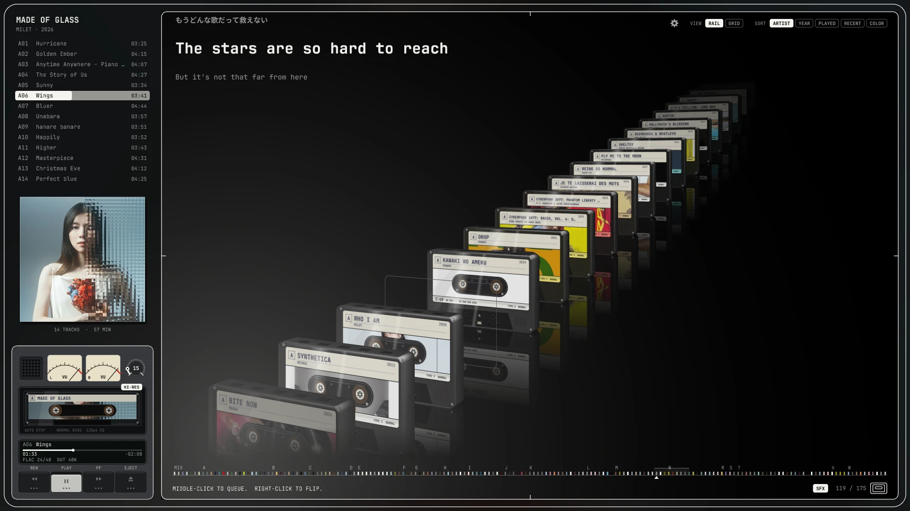

# Tapedeck

**A cassette-wall music player for your local library.**



Tapedeck turns every album folder into a cassette on a 3D shelf. Pick one and
it is pulled from the rail, turned toward you, and dropped into a cassette
deck, where its reels wind from one side to the other as the music plays.
Under the visuals is a careful player: tracks reach the sound server exactly as
they were decoded, with no resampling.

It is written in Rust with [macroquad](https://github.com/not-fl3/macroquad)
for the window and 3D, [rodio](https://github.com/RustAudio/rodio) and
[symphonia](https://github.com/pdeljanov/Symphonia) for audio, and
[lofty](https://github.com/Serial-ATA/lofty-rs) for tags.

## Features

- **A shelf of tapes.** C-60 style cassettes with your cover art behind clear
  plastic, floor reflections, and a light in the color of the playing album.
  Prefer a flat view? Switch to a grid of covers.
- **A real-feeling deck.** Piano keys (REW, PLAY, FF, EJECT), stereo VU
  meters, a volume ring, an LCD readout, and optional mechanical sound effects.
- **The back of the tape.** Right-click a cassette to turn it over and read its
  J-card; click a track to play it.
- **Lyrics.** Timed `.lrc` lyrics play karaoke-style; untimed ones scroll.
- **Queue and mixtapes.** Queue albums or single tracks, and record your own
  mixtapes from tracks across the library.
- **Search** by artist, album, year, genre or track title, and **sort** by
  artist, year, play count, recently played or cover color.
- **Desktop integration.** Shows up in status bars and responds to media keys
  through MPRIS.
- **Bit-perfect playback.** The output opens at each track's own sample rate
  and channel count in 32-bit float. The deck shows the file's format and what
  happens to it on the way out.
- **Keyboard first.** Every action has a key, and held keys repeat.

## Requirements

- Linux, with X11 or XWayland and OpenGL
- Rust 1.88 or newer
- Development files for ALSA, X11 and OpenGL:
  - Debian / Ubuntu: `sudo apt install pkg-config libasound2-dev libx11-dev libxi-dev libgl1-mesa-dev`
  - Arch: `sudo pacman -S base-devel alsa-lib libx11 libxi mesa`

Optional, at run time:

| What | Used for |
| --- | --- |
| fontconfig, JetBrains Mono, Noto Sans CJK | The interface fonts and Japanese/Korean titles. Without them, the system monospace font is used. |
| A D-Bus session | Status bars and media keys (MPRIS). |
| xdg-desktop-portal | The folder chooser when picking the music folder. |
| PipeWire (`pw-metadata`) | Showing when the sound server resamples. |

## Getting started

```sh
git clone https://github.com/Biirthday/tapedeck.git
cd tapedeck
cargo run --release
```

To install the binary into `~/.cargo/bin`:

```sh
cargo install --path .
```

Tapedeck reads the system's music folder (usually `~/Music`). To use another
one, open the settings (`Ctrl+,` or `F2`) and choose **Music folder**:
**BROWSE** opens the desktop's folder chooser, and **TYPE** lets you enter a
path (Tab completes it). The `MUSIC_DIR` environment variable overrides the
saved choice.

### Organizing your library

- **One folder per album.** Every folder that contains audio files becomes a
  tape. Album, artist, year and genre come from the tags of its first track;
  without tags, the folder names stand in for the album and artist.
- **Formats:** FLAC, ALAC and AAC (`.m4a`), MP3, Ogg Vorbis and WAV. Opus is
  not supported yet (the bundled decoders have no Opus codec), so `.opus` files
  are not listed.
- **Covers** come from `folder.jpg`, `cover.jpg` or `front.jpg` (or `.png`) in
  the album folder, or from the art embedded in the first track.
- **Lyrics** come from an `.lrc` file next to each track, or from the same path
  inside a separate lyrics folder: any top-level folder of the library that
  holds `.lrc` files and no audio, whatever it is called. For example:

  ```
  Music/
  ├── Artist/Album/01 Song.flac
  └── Lyrics/Artist/Album/01 Song.lrc
  ```

## Using Tapedeck

Press `?` in the app to see every shortcut.

### Keyboard

| Key | Action |
| --- | --- |
| `←` `→` | Previous / next tape |
| `↑` `↓` | Previous / next track; on a turned tape, pick a track on its J-card |
| `Enter` | Play the tape (or J-card track) in focus |
| `Space` | Play / pause |
| `,` `.` | Previous / next track |
| `[` `]` | Back / ahead by the seek step (10 s by default) |
| `-` `=` | Volume down / up |
| `Home` | Bring the playing tape back into view |
| `Tab` | Switch between the rail and the grid |
| Type anything | Search; `←` `→` step through matches, `Esc` clears |
| `F5` | Rescan the music folder |
| `F11` | Fullscreen |
| `Ctrl+,` or `F2` | Settings |
| `?` | Shortcut sheet |

In the grid, all four arrows move through the albums.

### Mouse

| Action | Effect |
| --- | --- |
| Click a tape | Play it. Click the gap it leaves on the rail (or EJECT) to take it out. |
| Middle-click | Queue a tape or a track. With `Shift`, it plays next. |
| Right-click a tape | Turn it over to read its J-card. In the grid, open the album's tracklist. |
| Wheel or drag | Move along the rail. |
| Index strip | Click or drag to jump; it marks the playing tape and search hits. |
| Progress bar | Click or drag to seek. |
| Volume ring | Turn it, or scroll over it. |

### Queue and mixtapes

Queued tracks play before the current tape continues; the **UP NEXT** badge
shows what is coming. Click it to open the queue, where you can play, reorder
(drag) or remove (right-click) entries.

To make a mixtape, click the blank tape at the head of the rail and name it.
Then right-click tracks in the side list to record them onto it; the **REC**
badge shows where they go. Right-click a track on a mixtape to remove it, and
press `Delete` twice on a mixtape to erase it.

When a tape ends and the queue is empty, the next tape on the rail starts.

## Settings

Open them with `Ctrl+,`, `F2` or the gear at the top right. Choices take effect
immediately and are saved.

- **Playback:** volume, seek step, sound effects, MPRIS
- **Look:** view, sort, fullscreen, colors from the cover, floor reflections,
  reflections on the plastic, cover light
- **Motion:** tape animation speed, lyrics fill pace, key repeat rate
- **Performance:** frame rate while playing and when idle
- **Library:** music folder (browse, type, rescan), show the control hints again

### Files

| Path | Contents |
| --- | --- |
| `~/.config/tapedeck/state.json` | Settings, position, volume, queue, play counts |
| `~/.config/tapedeck/mixtapes.json` | Your mixtapes |
| `~/.cache/tapedeck/` | Cover colors and the cover shared with the desktop |

## Audio quality

Decoding matches ffmpeg sample for sample for FLAC (16 and 24 bit, 44.1 to
96 kHz) and ALAC. Each track opens the output at its own rate, so Tapedeck
never resamples or truncates. Whatever conversion happens after that is up to
the sound server, and the deck tells you about it: `FLAC 24/96  OUT 96K
PW>48K`, for example, means PipeWire's graph is running at 48 kHz and converts.

To let PipeWire follow each track's rate instead, allow those rates. Your DAC
must support them, and other streams playing at the same time keep the graph at
their rate:

```
# ~/.config/pipewire/pipewire.conf.d/rates.conf
context.properties = { default.clock.allowed-rates = [ 44100 48000 88200 96000 ] }
```

## Development

Two examples check the audio path:

```sh
# Compare decoded PCM with ffmpeg
cargo run --release --example verify_decode -- FILE...
# Play silently and print the format the sound server receives
cargo run --release --example verify_output -- FILE...
```

Debug environment variables:

| Variable | Effect |
| --- | --- |
| `TAPEDECK_PROFILE=1` | Print the time each stage of a frame takes, and the frame rate |
| `TAPEDECK_KEYS=1` | Print the keys the window receives |
| `TAPEDECK_SCREENSHOT=out.png` | Render a few seconds, save a frame and exit |
| `TAPEDECK_VIEW=grid` | Start in the grid |
| `TAPEDECK_SEARCH=text` | Start with a search |
| `TAPEDECK_FLIP=n` | Start with tape `n` turned over |

`web-prototype/` holds the first browser version (Node.js), kept for reference.

## License

MIT. See [LICENSE](LICENSE).
